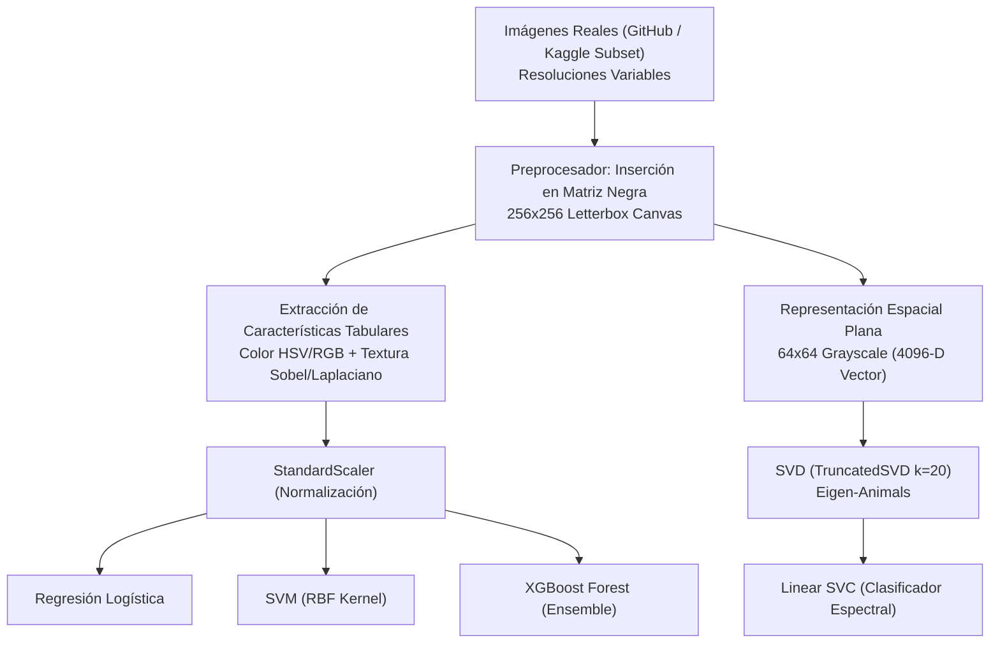

# Arquitectura Técnica: Clasificador de Perros y Gatos (Cats vs Dogs ML)

## 1. Resumen Ejecutivo
El presente proyecto implementa un pipeline integral de visión artificial y aprendizaje automático para la clasificación binaria de fotografías reales de **perros** (`perros`) y **gatos** (`gatos`). Se utilizaron imágenes de animales domésticos en condiciones naturales, con diferentes proporciones de aspecto, iluminaciones y texturas.

Para resolver la distorsión geométrica introducida por operaciones estándar de redimensionado (`resize` indiscriminado), el pipeline incorpora una técnica de **padding en matriz negra (letterbox zero-padding)** que preserva intacta la relación de aspecto espacial original.

---

## 2. Diagrama de Flujo del Pipeline


---

## 3. Preprocesamiento: Inserción en Matriz Negra
Cuando una imagen se somete a `cv2.resize(img, (256, 256))`, la morfología del animal sufre aplastamiento o elongación artificial. Para garantizar invariancia geométrica:
1. **Factor de escala:** $s = \min\left(\frac{256}{W_{orig}}, \frac{256}{H_{orig}}\right)$.
2. **Dimensiones escaladas:** $W' = \text{round}(W_{orig} \cdot s)$, $H' = \text{round}(H_{orig} \cdot s)$.
3. **Canvas neutro:** Matriz nula $\mathbf{M} \in \mathbb{R}^{256 \times 256 \times 3}$ con valores 0 (negro).
4. **Centrado simétrico:** 
   $$y_{offset} = \lfloor (256 - H') / 2 \rfloor, \quad x_{offset} = \lfloor (256 - W') / 2 \rfloor$$
5. **Máscara activa:** Las características se extraen focalizadamente sobre la región con intensidad $> 5$, eliminando el sesgo del fondo negro circundante.

---

## 4. Modelos Entrenados y Justificación Teórica

### 4.1 Regresión Logística
Modelo lineal discriminante con regularización L2. Modela la probabilidad a posteriori:
$$P(Y = 1 \mid \mathbf{x}) = \frac{1}{1 + e^{-\mathbf{w}^T \mathbf{x} - b}}$$

### 4.2 Support Vector Machine (SVM con Kernel RBF)
Construye un hiperplano óptimo de máxima separación en un espacio de dimensión infinita mediante el truco del kernel gaussiano:
$$K(\mathbf{x}_i, \mathbf{x}_j) = \exp(-\gamma \|\mathbf{x}_i - \mathbf{x}_j\|^2)$$

### 4.3 SVD + Clasificador Lineal (Eigen-Animals)
Aplica descomposición en valores singulares a la matriz de imágenes planas normalizadas $\mathbf{X} \in \mathbb{R}^{n \times 4096}$:
$$\mathbf{X} = \mathbf{U} \mathbf{\Sigma} \mathbf{V}^T$$
Las 20 primeras componentes singulares de $\mathbf{V}^T$ constituyen los **Eigen-Animals**, capturando patrones espaciales globales (silueta de orejas, hocico y ojos) que son clasificados por una Support Vector Machine lineal.

### 4.4 XGBoost Forest (Extreme Gradient Boosting)
Ensemble de árboles de decisión aditivos optimizados por gradiente con regularización $\Omega(f)$:
$$\mathcal{L}^{(t)} = \sum_{i=1}^n l(y_i, \hat{y}_i^{(t-1)} + f_t(\mathbf{x}_i)) + \Omega(f_t)$$
Captura interacciones no lineales entre canales de saturación de pelaje y magnitudes de gradiente textural.

---

## 5. Estructura de Directorios del Repositorio
```
├── data/
│   ├── raw/
│   │   ├── gatos/          # Fotografías reales descargadas (60 JPGs)
│   │   ├── perros/         # Fotografías reales descargadas (60 JPGs)
│   │   └── dataset_info.json
│   └── processed/
│       ├── preprocessor.py # Módulo reutilizable de inserción en matriz negra
│       ├── features_animales.csv
│       └── dataset_animales.npz
├── models/
│   ├── logistic_regression.joblib
│   ├── svm_rbf.joblib
│   ├── svd_pipeline.joblib
│   ├── xgboost_forest.joblib
│   ├── scaler.joblib
│   ├── label_encoder.joblib
│   ├── metrics.json
│   ├── confusion_matrices.png
│   ├── svd_eigen_animals.png
│   └── predict.py          # Herramienta CLI de inferencia
├── dashboard/
│   ├── app.py              # Aplicación Streamlit interactiva
│   ├── requirements.txt
│   └── Dockerfile
├── docs/
│   ├── index.html          # Portal web estático de la arquitectura
│   └── arquitectura_tecnica.md
├── reports/
│   ├── informe_clasificacion.md
│   └── metricas_resumen.csv
├── presentation/
│   ├── index.html          # Diapositivas interactivas del proyecto
│   └── styles.css
└── README.md               # Documentación maestra del proyecto
```
