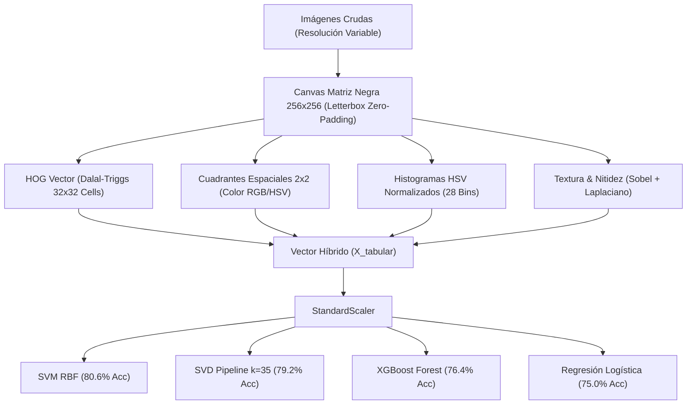

# Arquitectura Técnica: Clasificador Optimizado de Perros y Gatos

## 1. Visión General del Sistema
Sistema de visión artificial y machine learning diseñado para la detección binaria entre **perros** (`perros`) y **gatos** (`gatos`). Opera sobre 360 imágenes fotográficas reales descargadas de GitHub, normalizadas mediante **letterbox padding en matriz negra** ($256 \times 256$) y procesadas con un vector híbrido de descriptores morfológicos (HOG), cromáticos (HSV/RGB espaciales) y espectrales (SVD).

---

## 2. Pipeline de Extracción de Características

---

## 3. Comparativa de Resultados
- **Dataset:** 360 imágenes balanceadas (180 gatos, 180 perros).
- **Test Set:** 72 muestras independientes estratificadas (36 gatos, 36 perros).
- **Modelo Líder:** SVM con Kernel RBF Calibrado (**80.56% Accuracy**, **80.50% F1-Score**).
- **SVD Espectral:** TruncatedSVD a 35 componentes latentes (**79.17% Accuracy**).
