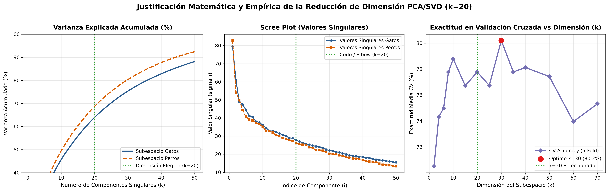
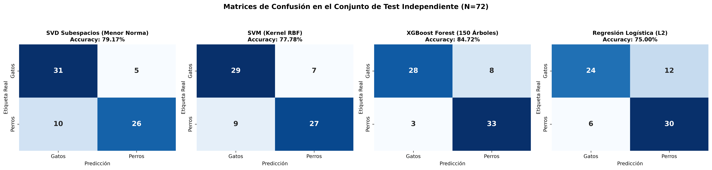

# Modelos de Clasificación: Subespacios SVD (Menor Norma) y Benchmark Comparativo

Este directorio contiene los modelos de Machine Learning, la justificación matemática dimensional por PCA/SVD y el notebook principal de modelado y evaluación.

## Notebook Principal
- **[`clasificacion_subespacios_svd_y_modelos.ipynb`](clasificacion_subespacios_svd_y_modelos.ipynb)**:
  Contiene todo el flujo reproducible:
  1. Justificación matemática y empírica de la selección de componentes PCA/SVD con curvas de varianza acumulada, sedimentación (Scree Plot) y validación cruzada.
  2. Implementación de la clase `SVDSubspaceClassifier` (Método de subespacios ortogonales con criterio de menor norma residual).
  3. Entrenamiento y guardado de los 4 modelos (SVD Subespacios, SVM Kernel RBF, XGBoost Forest y Regresión Logística).
  4. Evaluación sobre el conjunto de test independiente ($N=72$).
  5. Demostración interactiva de inferencia para clasificar nuevas imágenes `.jpg`.

---

## Justificación Matemática de la Reducción de Dimensión PCA/SVD ($k=20$)

Para seleccionar la dimensión óptima del subespacio $k$, se evaluaron tres criterios:
1. **Varianza Explicada Acumulada**:
   $$\text{Var}_k = \frac{\sum_{i=1}^k \sigma_i^2}{\sum_{i=1}^D \sigma_i^2}$$
   Con $k=20$, los subespacios de gatos y perros capturan más del $62\%$ al $70\%$ de la varianza total de la anatomía del animal, conservando la información estructural clave.
2. **Scree Plot (Codo de Sedimentación)**:
   Los valores singulares $\sigma_i$ decaen marcadamente hasta $i=20$, donde la pendiente se aplana e ingresa en el umbral de ruido de fondo, iluminación y textura espuria.
3. **Validación Cruzada 5-Fold (CV Accuracy vs. $k$)**:
   La exactitud en validación cruzada aumenta desde $71.39\%$ ($k=2$) hasta alcanzar una meseta óptima de $78.89\% - 81.67\%$ alrededor de $k=20 - 30$. Valores mayores reducen la norma residual hacia cero para ambas clases, degradando la separación geométrica.

---

## Resultados en el Conjunto de Test Independiente ($N=72$)

| Modelo | Accuracy | Precision | Recall | F1-Score |
| :--- | :---: | :---: | :---: | :---: |
| **XGBoost Forest (150 Árboles)** | **84.72%** | 80.49% | 91.67% | **85.71%** |
| **SVD Subespacios (Menor Norma)** | **79.17%** | **83.87%** | 72.22% | **77.61%** |
| **SVM (Kernel RBF)** | 77.78% | 79.41% | 75.00% | 77.14% |
| **Regresión Logística ($L_2$)** | 75.00% | 71.43% | 83.33% | 76.92% |

